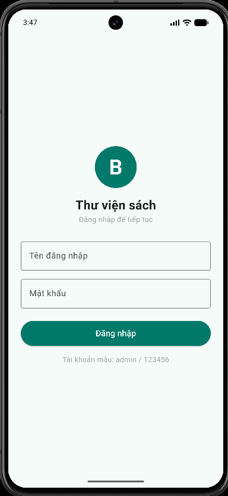
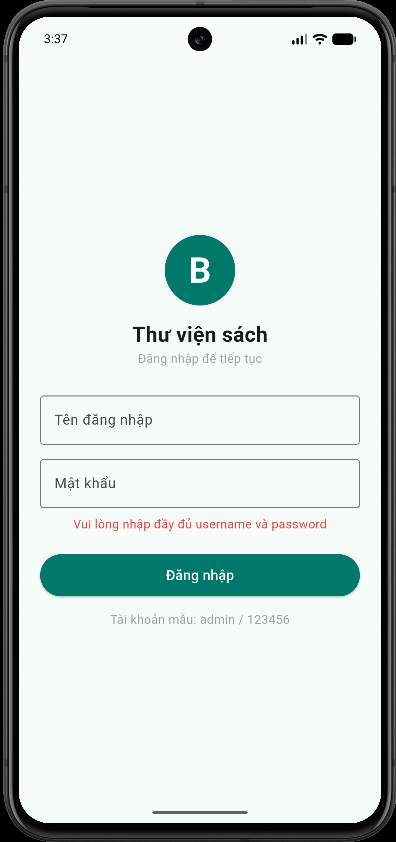
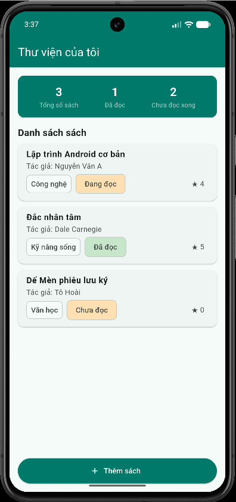
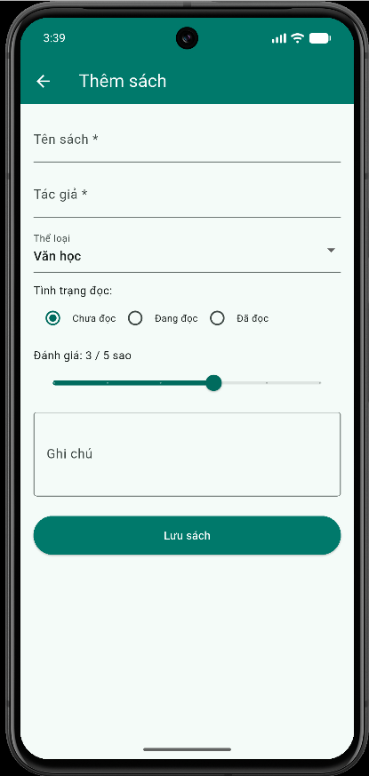
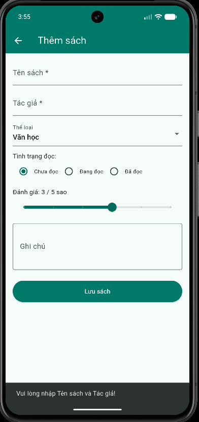
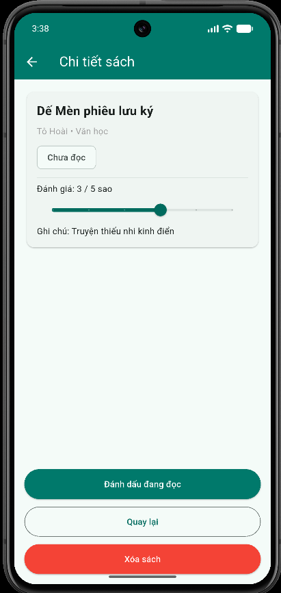

## BÁO CÁO HÌNH ẢNH VÀ MÔ TẢ NỘI DUNG THỰC HIỆN

| Màn hình | Hình ảnh                                                                                                                                                                  | Mô tả nội dung đã làm |
| :--- |:--------------------------------------------------------------------------------------------------------------------------------------------------------------------------| :--- |
| **Đăng nhập (LoginActivity)** |  *(Hình 1: Màn hình Đăng nhập)*   *(Hình 2: Báo lỗi khi sai/bỏ trống)*   | **Thành phần & Lớp:** - Lớp: `LoginScreen` (`lib/views/login_screen.dart`). - Thành phần: `CircleAvatar` hiển thị logo, `TextField` nhập tên đăng nhập, `TextField` (`obscureText: true`) nhập mật khẩu, `Text` báo lỗi, `ElevatedButton` Đăng nhập.  **Xử lý sự kiện & Hàm:** - Dùng `TextEditingController` (`_usernameController`, `_passwordController`) lấy dữ liệu từ các ô nhập. - Hàm `_handleLogin()`: Kiểm tra bỏ trống, nếu thiếu thông tin thì cập nhật `_errorMessage = 'Vui lòng nhập đầy đủ username và password'`. So sánh tài khoản cố định `admin` / `123456`. Khi đăng nhập thành công, gọi `Navigator.pushReplacement` để chuyển sang `HomeScreen` và không cho quay lại màn hình đăng nhập. |
| **Danh sách sách (MainActivity)** |  *(Hình 3: Danh sách sách và thống kê)*                                                                                        | **Thành phần & Lớp:** - Lớp: `HomeScreen` (`lib/views/home_screen.dart`), `Book` (`lib/models/book.dart`). - Thành phần: `Container` làm khối thống kê (Tổng số sách, Đã đọc, Chưa đọc xong), `ListView.builder` hiển thị danh sách dạng `Card` + `ListTile` (gồm `Text` tên sách, tác giả, `Chip` thể loại, trạng thái, sao), `ElevatedButton.icon` Thêm sách.  **Xử lý sự kiện & Hàm:** - Thống kê tính bằng các hàm `where()` trên danh sách `_books`: `total = _books.length`, `read = _books.where((b) => b.status == 'Đã đọc').length`, `unread = total - read`. - Nhấn nút Thêm sách: Dùng `Navigator.push` đến `AddBookScreen` nhận kết quả `newBook` và `setState()` để cập nhật danh sách. - Nhấn vào ô sách: Dùng `Navigator.push` mở `BookDetailScreen`, truyền hàm callback `onDelete` (xóa sách khỏi `_books`) và `onUpdate` (gọi `setState` cập nhật lại giao diện và thống kê). |
| **Thêm sách (AddBookActivity)** |  *(Hình 4: Màn hình Thêm sách)*   *(Hình 5: Báo lỗi khi bỏ trống)* | **Thành phần & Lớp:** - Lớp: `AddBookScreen` (`lib/views/add_book_screen.dart`). - Thành phần: `TextField` tên sách, tác giả, ghi chú (`maxLines: 3`), `DropdownButtonFormField` chọn thể loại, `Radio` chọn tình trạng đọc (Chưa đọc, Đang đọc, Đã đọc), `Slider` chọn sao đánh giá, `ElevatedButton` Lưu sách.  **Xử lý sự kiện & Hàm:** - Hàm `_saveBook()`: Kiểm tra nếu trống tên sách hoặc tác giả thì hiển thị `SnackBar` thông báo lỗi *"Vui lòng nhập Tên sách và Tác giả!"*. - Khi thông tin hợp lệ: Khởi tạo đối tượng `Book` mới và gọi `Navigator.pop(context, newBook)` để trả dữ liệu về `HomeScreen`. |
| **Chi tiết sách (BookDetailActivity)** |  *(Hình 6: Màn hình Chi tiết sách)*                                                                                 | **Thành phần & Lớp:** - Lớp: `BookDetailScreen` (`lib/views/book_detail_screen.dart`). - Thành phần: `Card` chứa `Text` tên sách, tác giả, thể loại, ghi chú, `Slider` chỉnh số sao, `ElevatedButton` Đánh dấu đang đọc / Đánh dấu đã đọc, `OutlinedButton` Quay lại, `ElevatedButton` Xóa sách.  **Xử lý sự kiện & Hàm:** - Nhận đối tượng `Book` qua constructor. - Nhấn Đánh dấu đang đọc / Đã đọc: Đổi thuộc tính `status` của `book`, gọi `setState()` và `widget.onUpdate()` để cập nhật lại danh sách và thống kê. - Nhấn Slider: Cập nhật biến `rating` của sách. - Nhấn nút Quay lại: Gọi `Navigator.pop(context)`. - Nhấn nút Xóa sách: Gọi `widget.onDelete()` xóa khỏi danh sách `_books` và gọi `Navigator.pop(context)` để quay về `HomeScreen`. |